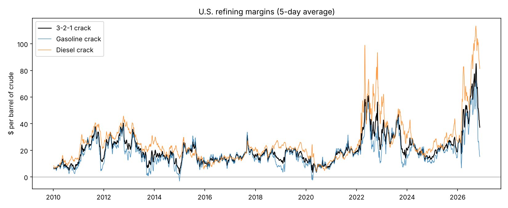
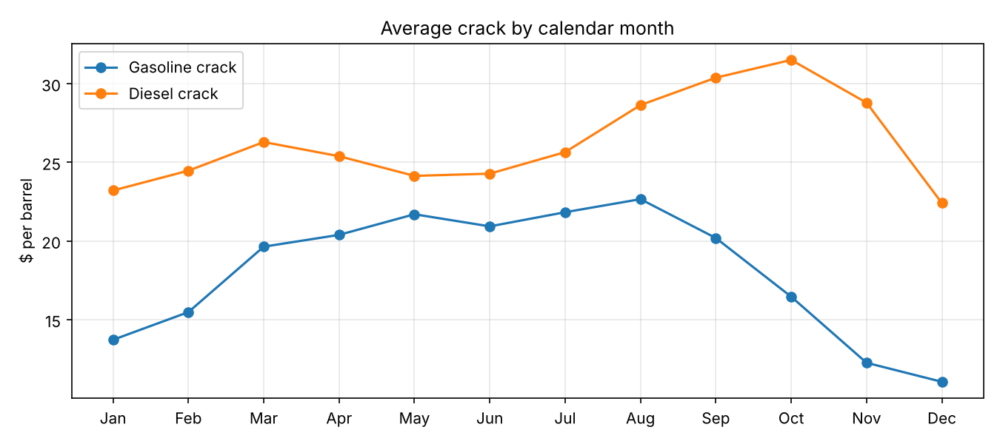
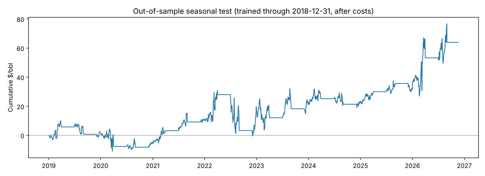

# U.S. Refining Margins: 3-2-1 Crack Spread Analysis (2010–2026)

A refinery turns crude oil into gasoline and diesel. The **crack spread** is the gross margin on that conversion. The industry benchmark, the **3-2-1 crack**, assumes 3 barrels of crude become 2 barrels of gasoline and 1 barrel of diesel:

```
3-2-1 crack ($/bbl of crude) = (2 x gasoline + 1 x diesel − 3 x crude) / 3
```

This project measures U.S. Gulf Coast refining margins from 2010 to November 2026, tests whether their seasonal pattern holds **out of sample**, and checks how much margin risk moves with crude prices.

## Questions
1. How have Gulf Coast refining margins changed since 2010, and what drove the largest moves?
2. Is there a reliable seasonal pattern in gasoline and diesel margins?
3. Does a seasonal rule learned on 2010–2018 still work on 2019–2026 data it never saw, after costs?
4. Do refining margins move with crude prices, or independently?

## Data
Daily spot prices from the U.S. Energy Information Administration (EIA):

| Series | EIA ID | Units |
|---|---|---|
| WTI crude, Cushing OK | `RWTC` | $/bbl |
| Gulf Coast conventional regular gasoline | `EER_EPMRU_PF4_RGC_DPG` | $/gal (converted to $/bbl, × 42) |
| Gulf Coast ultra-low sulfur diesel | `EER_EPD2DXL0_PF4_RGC_DPG` | $/gal (converted to $/bbl, × 42) |

Gulf Coast prices are used because most U.S. refining capacity sits on the Gulf Coast. Crude is priced at WTI Cushing; published Gulf Coast margin benchmarks may use a different crude (for example, Louisiana Light Sweet), so levels here can differ from industry figures. One day is excluded: **2020-04-20**, when WTI spot settled at −$36.98. A margin computed against negative crude measures a storage squeeze at Cushing, not refining economics.

## Method
- **Cracks:** 3-2-1, gasoline crack (gasoline − WTI) and diesel crack (diesel − WTI), all in $/bbl.
- **Seasonality:** average crack level and average month-over-month change by calendar month, across years.
- **Out-of-sample test:** learn the calendar months in which the 3-2-1 crack rose on average during **2010–2018** only. On **2019–2026**, hold a long crack position only in those months. Positions use the prior day's signal (no look-ahead), and every position change pays $0.05/bbl.
- **Robustness:** different train/test split years, higher costs (up to $1/bbl), and excluding 2026.

## Results
Period: 2010-01-04 to 2026-11-17 (16.9 years, 4,170 trading days).

| Metric | Value |
|---|---|
| Average 3-2-1 crack | $20.79/bbl (median $18.32) |
| Highest in sample | **$90.85/bbl on 2026-09-23** |
| Days with a negative 3-2-1 crack | 0.02% |
| Lowest annual average | $8.25 (2010), $9.02 (2020) |
| Highest annual averages | $36.76 (2022), **$50.02 (2026 to date)** |

**Seasonality (average 3-2-1 crack by month):** lowest in **December ($14.84)**, highest in **August ($24.66)**. The crack rose in March in 76% of years and fell in November in 82% of years.
- Gasoline crack peaks in **August** and bottoms in December.
- Diesel crack peaks in **October** and bottoms in December.

**Out-of-sample test (trained 2010–2018, tested 2019–2026):**

| | Seasonal rule | Buy and hold |
|---|---|---|
| Months learned | Jan, Feb, Mar, Jul, Aug, Dec | all |
| Months held in test | 47 | all |
| Profitable months | 63.8% | — |
| Total, after costs | **+$63.84/bbl** | +$21.76/bbl |
| Max drawdown | −$31.22/bbl (Mar–Dec 2022) | −$56.24/bbl (Sep–Nov 2026) |
| Annualized Sharpe (on daily PnL) | **0.36** | 0.09 |
| Worst day | −$13.71/bbl | −$20.06/bbl |

| Robustness check | Result |
|---|---|
| Train through 2016, 2017, 2018 or 2019 | Same six months learned every time; 63–64% profitable months |
| Exclude 2026 | +$31.32/bbl vs +$6.52 buy and hold |
| Cost raised to $1.00/bbl per change | +$33.44/bbl |
| Contribution of 2026 alone | +$32.52/bbl (about half of the total) |
| Worst test year | 2020: −$6.59/bbl |

**Crude vs. margin:** daily changes in gasoline and diesel prices each correlate about **+0.5** with WTI, but daily changes in the 3-2-1 crack correlate only **−0.10** with WTI.





## What I found
**Margin regimes follow supply shocks, not crude prices.** The 3-2-1 crack averaged $27.49 in 2012, fell to $12.56 in 2016, collapsed to $9.02 during COVID in 2020, then hit $36.76 in 2022 after Russia's invasion of Ukraine pushed diesel cracks to records. 2026 is in a different league: after the February 28 Middle East conflict and the de facto closure of the Strait of Hormuz, this WTI-based Gulf Coast 3-2-1 crack reached $90.85/bbl on September 23, the highest value in the 2010–2026 sample. Diesel led both shocks, which matches the global diesel shortages reported in [2022](https://www.spglobal.com/energy/en/news-research/latest-news/crude-oil/032822-refinery-margin-tracker-record-high-global-diesel-cracks-propel-margins-upward) and [2026](https://www.energypolicy.columbia.edu/publications/beyond-crude-iran-war-reveals-refined-products-as-an-energy-security-blind-spot/).

**Seasonality is real and stable.** Gasoline margins build from winter into the summer driving season and peak in August. Diesel peaks in October, ahead of harvest and heating season. Both bottom in December. The same six months came out of every training window I tried.

**The seasonal pattern survives out of sample, but it is not free money.** Trained only on 2010–2018, the rule earned three times buy and hold on 2019–2026 after costs, and stayed positive with costs 20 times higher. But 2026 alone delivered about half the profit, because the rule happened to be long during the Hormuz-driven spikes. Without 2026 the edge is smaller, and 2020 lost money. Risk-adjusted, the rule is better than buy and hold (Sharpe 0.36 vs 0.09) with a smaller worst drawdown, but a Sharpe of 0.36 is modest: it gave back $31/bbl through 2022 as diesel-driven margins swung wildly.

**Margin risk is a separate risk from crude.** Product prices move with crude, but the margin barely does (−0.10). For a refiner, hedging crude does not hedge the crack; the margin needs its own hedge. The 2020-04-20 negative-WTI day shows why the data needs care: left in, it alone pushed this correlation to −0.38.

## Limitations
- Spot cracks are not directly tradable. A real trade would use RBOB, ULSD and WTI futures, with roll costs, margin and basis risk between NYMEX and Gulf Coast spot prices.
- The 3-2-1 ratio is a benchmark. Actual refinery yields, crude slates and product mixes differ.
- Sharpe is computed on daily PnL in $/bbl with no capital base, so it measures consistency, not return on capital
- 47 test months is a small sample, and one extreme year drives much of the result.
- Seasonality learned on the past can break if demand patterns or fuel specifications change.

## Run it
```bash
pip install -r requirements.txt
python run_analysis.py --xls-dir data    # uses the EIA files in data/
python run_analysis.py                   # or download directly from EIA
pytest -q                                # tests also run on every push via GitHub Actions
```
Options: `--region nyh` for New York Harbor products, `--split 2017-12-31` to change the training period, `--cost 0.25` to change trading costs.
